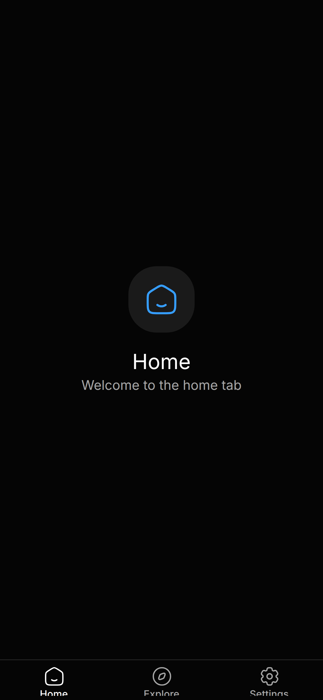
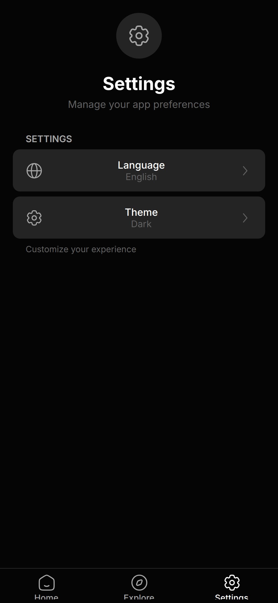
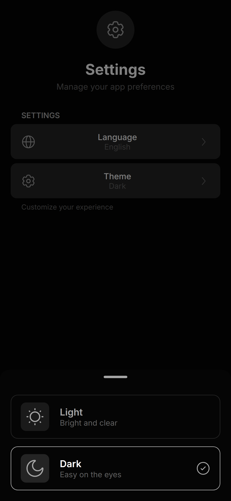

# Allay

A ready-to-use template for React Native apps with Expo, Expo Router, Tamagui and Zustand: navigation, theming, translations, an API layer and tests already wired up.

[](https://github.com/raniellimontagna/allay-template/actions/workflows/ci.yml)
[](LICENSE)
[](package.json)

<p align="center">
  
  
  
</p>

## Use this template

1. On GitHub, click **Use this template** > **Create a new repository**, or with the GitHub CLI:

   ```bash
   gh repo create my-app --template raniellimontagna/allay-template --private --clone
   ```

2. Rename the app: `name` in `package.json`, and `name`, `slug`, `scheme`, `ios.bundleIdentifier` and `android.package` in `app.json` (they default to `allay` and `com.anonymous.allay`).
3. Replace the icons and splash image in `assets/`.
4. Copy `.env.example` to `.env.local` and set `EXPO_PUBLIC_API_URL` to your backend. `.env.local` is already ignored by git.
5. Edit the translations in `src/locales/` and start adding screens under `src/app/`.

## What's included

- **Expo SDK 54** with TypeScript, React Native 0.81 and the New Architecture enabled.
- **Expo Router 6:** file-based navigation with a tab layout (Home, Explore, Settings) and typed routes.
- **Tamagui:** design system with light and dark themes and the Inter font.
- **Zustand:** global state persisted to AsyncStorage (the selected theme, for example).
- **TanStack Query + Axios:** an API client with interceptors and a sample user service.
- **i18n:** i18next and react-i18next with English, Portuguese and Spanish; the starting language comes from the device (expo-localization) and can be changed in Settings.
- **UI pieces:** bottom sheets (`@gorhom/bottom-sheet`), toasts (`@tamagui/toast`), an offline banner (NetInfo), an animated button with haptic feedback, a loading state and a safe-area container.
- **Settings feature:** a complete example with language and theme sheets.
- **Quality:** Jest with Testing Library (tests next to each component and hook), Biome for linting and formatting, and a GitHub Actions workflow that runs lint, type-check and tests.

## Getting started

Prerequisites: Node.js 20 or newer and [pnpm](https://pnpm.io). The `android` and `ios` scripts build the native app locally, so they also need Android Studio or Xcode.

```bash
pnpm install
pnpm start      # start Metro
pnpm android    # build and run on an Android emulator or device
pnpm ios        # build and run on the iOS simulator
pnpm web        # run in the browser
```

For the web target, Expo needs `react-dom` and `react-native-web` installed in the project; if it reports them missing, add them with `npx expo install react-dom react-native-web`.

## Scripts

| Script | What it does |
| --- | --- |
| `pnpm start` | Start the Expo dev server (Metro) |
| `pnpm android` / `pnpm ios` | Build and run the native app (`expo run`) |
| `pnpm web` | Start the dev server for the web |
| `pnpm lint` | Lint `src/` with Biome |
| `pnpm format` | Format `src/` with Biome |
| `pnpm check` | Lint and format `src/` with Biome, applying fixes |
| `pnpm typecheck` | Type-check with `tsc --noEmit` |
| `pnpm test` | Run the Jest tests |
| `pnpm test:watch` | Run the tests in watch mode |
| `pnpm test:coverage` | Run the tests with a coverage report |

## Project structure

```text
src/
  app/          routes (Expo Router): the (tabs) group, about and the root layout
  components/   shared UI (layout and ui components)
  features/     feature modules with their own screens, components and sheets (settings)
  hooks/        useApi, useHaptics, useLoadFonts, useNetwork
  lib/          i18n setup
  locales/      translation files (en, pt, es)
  providers/    i18n and React Query providers
  services/     API client and services
  stores/       Zustand stores
  testing/      test utilities (render with all providers)
  theme/        Tamagui config
  utils/        storage helpers
__mocks__/      Jest mocks (Reanimated, icons, Axios)
docs/           architecture, conventions, components and CI notes
```

## Documentation

- [Architecture](docs/ARCHITECTURE.md)
- [Conventions](docs/CONVENTIONS.md)
- [Components](docs/COMPONENTS.md)
- [CI](docs/CI.md)

## License

Released under the [MIT License](LICENSE).
